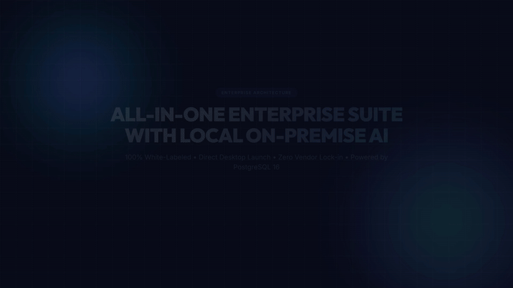
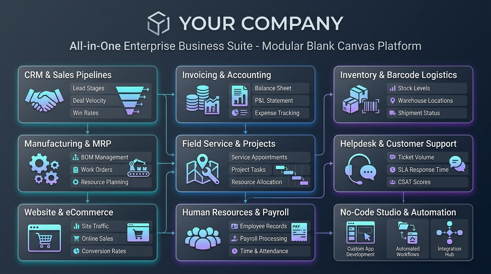
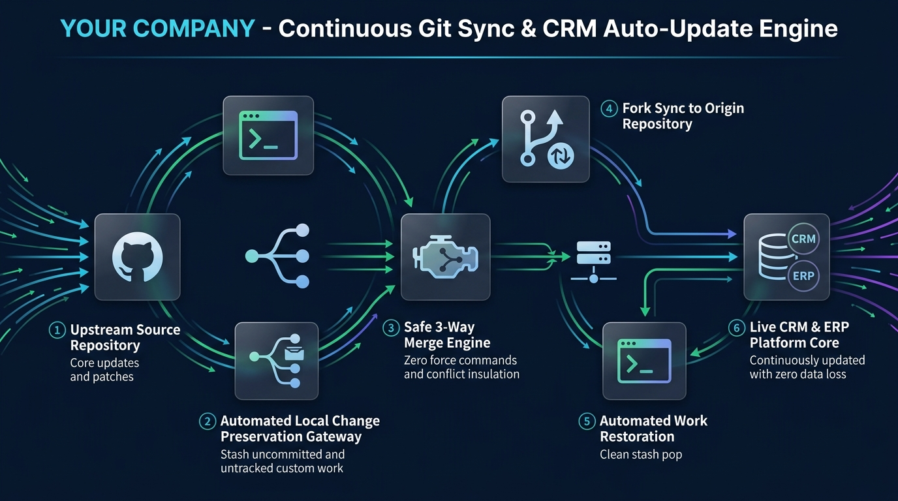
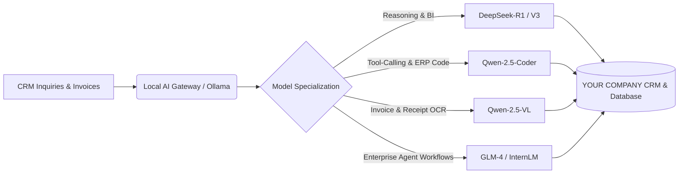

# 🏢 YOUR COMPANY - All-in-One Enterprise Business Suite

[](https://www.docker.com/)
[](https://www.postgresql.org/)
[](https://odoo-local.vercel.app)
[](https://github.com/xennials-dev/enterprise-erp-suite)
[](LICENSE)
[]()

A modern, blank-canvas, white-label Enterprise Resource Planning (ERP) and business management suite. Pre-configured with direct desktop access, unlocked modules, automated upstream synchronization, and zero vendor lock-in.

---

## 🎬 1080p Video Walkthrough & Portfolio Demo

[](docs/videos/odoo-showcase-master.mp4)

> [!TIP]
> **Showcase Master MP4 (1080p Full HD &bull; 30s &bull; H.264 / AAC)**:
> - 📹 **Download Master MP4**: [`docs/videos/odoo-showcase-master.mp4`](docs/videos/odoo-showcase-master.mp4) *(6.9 MB, 1920x1080, 30 fps, Stereo Audio Bed)*
> - 🚀 **Upwork Portfolio**: Ready for direct upload (under 100MB limit, ideal 30s duration, 16:9).
> - 🐙 **GitHub Ready**: Stream directly from repository releases or embed via HTML5 video.

---

## 📊 Platform Architecture & Core Features



The platform is designed around 9 integrated functional pillars that seamlessly communicate through a shared relational data layer:

| Pillar | Core Capabilities | Activation Status |
| :--- | :--- | :---: |
| **💼 CRM & Sales** | Lead stages, pipeline velocity, automated quotation generation, e-signatures, customer portals. | ⚡ Pre-Activated (Available on Launch) |
| **📊 Accounting & Invoicing** | Double-entry bookkeeping, P&L statements, balance sheets, bank feeds, expense reconciliation. | ⚡ Pre-Activated (Available on Launch) |
| **📦 Inventory & Logistics** | Multi-warehouse routing, automated reordering rules, barcode scanning, traceable lots/serials. | ⚡ Pre-Activated (Available on Launch) |
| **🏭 Manufacturing & MRP** | Multi-level Bills of Materials (BOM), shop floor work orders, production routing, capacity scheduling. | ⚡ Pre-Activated (Available on Launch) |
| **🛠️ Field Service & Projects** | Task delegation, interactive Gantt charts, employee timesheets, on-site service appointments. | ⚡ Pre-Activated (Available on Launch) |
| **🎧 Customer Helpdesk** | Multi-channel ticketing, custom SLA policies, customer satisfaction ratings, canned responses. | ⚡ Pre-Activated (Available on Launch) |
| **🌐 Website & eCommerce** | Drag-and-drop website editor, integrated web store, cart recovery, payment gateway processing. | ⚡ Pre-Activated (Available on Launch) |
| **👥 Human Resources** | Employee directories, time-off approvals, payroll management, recruitment pipelines, appraisals. | ⚡ Pre-Activated (Available on Launch) |
| **⚡ No-Code Studio & Automation** | Custom model design, visual form and kanban editors, automated triggers, scheduled server actions. | ⚡ Pre-Activated (Available on Launch) |

---

## 🔄 Continuous Git Sync & Upstream CRM Updates



> [!IMPORTANT]
> **How Your CRM Stays Continuously Updated Without Data Loss**:
> This failsafe 6-stage automation pipeline allows your CRM and ERP system to receive the latest upstream features, performance enhancements, and security patches from GitHub while protecting local modifications, custom modules, and uncommitted database schemas.

### The 6-Stage Failsafe Pipeline:
1. **Upstream Source Repository (`upstream/main`)**: Monitors official releases, security patches, and core engine enhancements on GitHub.
2. **Automated Preservation Gateway**: Runs `git stash push -u -m "pre-sync-backup"` before touching any branch. Both modified code and untracked files are safely stashed.
3. **Safe 3-Way Merge Engine**: Executes `git merge upstream/main` without destructive `--force` flags. If merge conflicts occur, the process halts immediately and insulates your stash.
4. **Fork Sync to Origin**: Pushes synchronized upstream changes directly to your GitHub fork (`origin/main`).
5. **Automated Work Restoration**: Automatically pops the stashed work (`git stash pop`) back into your active working tree.
6. **Live CRM Platform Core**: Your CRM reloads with latest core features while all local customizations remain intact.

#### Run Synchronization in One Command:
- **Windows (PowerShell)**:
  ```powershell
  .\scripts\sync-upstream.ps1 -UpstreamUrl "https://github.com/UPSTREAM_OWNER/UPSTREAM_REPO.git" -TargetBranch "main"
  ```
- **Linux / macOS / Git Bash**:
  ```bash
  ./scripts/sync-upstream.sh https://github.com/UPSTREAM_OWNER/UPSTREAM_REPO.git main
  ```

---

## 🤖 Open-Source AI & Chinese LLM Integration Recommendations

Integrating cutting-edge open-source Chinese Large Language Models (LLMs) transforms this suite into an autonomous, AI-native business platform. Because Chinese open-weights lead global benchmarks in reasoning, multilingual understanding, coding, and cost efficiency, they are ideal for self-hosted enterprise automation.



### 1. Recommended Model Lineup (Open Weights)

| Model Family | Developer | Recommended Variant | Key Strengths & ERP Fit |
| :--- | :--- | :--- | :--- |
| **DeepSeek** | DeepSeek AI | **DeepSeek-R1** (671B MoE / Distills: 14B, 32B)<br>**DeepSeek-V3** | Unrivaled reasoning, chain-of-thought analysis, mathematical accuracy, and cost efficiency. Perfect for complex CRM deal scoring, business intelligence synthesis, and contract analysis. |
| **Qwen 2.5** | Alibaba Cloud | **Qwen-2.5-72B-Instruct**<br>**Qwen-2.5-Coder-32B**<br>**Qwen-2.5-VL-72B** | World-class coding and function-calling. **Qwen-2.5-Coder** excels at generating SQL queries directly against PostgreSQL. **Qwen-2.5-VL** brings state-of-the-art vision for invoice OCR. |
| **GLM-4** | Zhipu AI | **GLM-4-9B-Chat** (128k context) | Exceptional bilingual (English/Chinese) tool calling, enterprise roleplay, and structured JSON output. Ideal for customer service and ticket resolution. |
| **InternLM 2.5** | Shanghai AI Lab | **InternLM2.5-20B-Chat** (1M context) | Long-context document ingestion. Capable of reading entire ERP audit logs, supplier contracts, and product catalogs in a single prompt. |
| **Yi-1.5** | 01.AI | **Yi-1.5-34B-Chat** | High-throughput conversational fluency and reasoning with low VRAM footprint. |

---

### 2. High-Impact Enterprise AI Use Cases

#### A. Conversational Business Intelligence (Natural Language to SQL)
- **Model**: `Qwen-2.5-Coder-32B` / `DeepSeek-Coder-V2`
- **Capability**: Non-technical staff can ask questions directly in the Discuss/Chat module:
  > *"What was our conversion rate for leads in North America last month compared to this month?"*
- The model queries PostgreSQL tables (`crm_lead`, `sale_order`, `account_move`), aggregates the numbers, and returns instant charts and summaries.

#### B. Intelligent Document & Invoice Processing (Zero-Cost OCR)
- **Model**: `Qwen-2.5-VL` (Vision-Language)
- **Capability**: When a vendor bill or receipt PDF/image is dropped into Accounting:
  - The vision model extracts vendor name, tax ID, line items, unit prices, and payment due dates.
  - Automatically creates a pre-filled draft bill in `account.move` ready for one-click manager approval.

#### C. Autonomous Customer Support & Helpdesk Tier-1 Resolution
- **Model**: `GLM-4-9B` or `Qwen-2.5-14B` + RAG
- **Capability**: 24/7 automated ticket classification and resolution:
  - Ingests customer support inquiries from email/web form.
  - Searches internal knowledge base articles and previous resolved tickets.
  - Generates human-like, accurate responses or executes actions (e.g. tracking a delivery order status).

#### D. Predictive CRM Lead Scoring & Autonomous Follow-up
- **Model**: `DeepSeek-R1`
- **Capability**: Evaluates prospect engagement, website visit frequency, company size, and communication tone to assign a dynamic win-probability score and auto-draft personalized follow-up sequences.

---

### 3. Quick Local Deployment via Ollama (Pre-Installed)

Because Ollama is already configured in the local environment, you can run any of these models locally with one command:

```bash
# Run Qwen 2.5 14B (balanced reasoning & function calling)
ollama run qwen2.5:14b

# Run DeepSeek-R1 Distill for high-grade reasoning
ollama run deepseek-r1:14b

# Run Qwen 2.5 Coder for database and code automation
ollama run qwen2.5-coder:14b
```

---

## 🌟 Key Platform Enhancements

### 1. 🚀 Direct Desktop Access (Zero-Login Bypass)
- Bypasses all login screens, credential forms, and database manager prompts.
- When navigating to `http://localhost:8069`, requests are automatically authenticated as Administrator (`admin`, UID 2) and land directly on the desktop dashboard (`/odoo`).

### 2. 🔓 Complete Module Unlocking
- All 21 standard "Upgrade" paywall cards (Accounting, Studio, Helpdesk, Timesheets, Field Service, Planning, Barcode, etc.) have been converted to standard **"Activate"** apps.
- Underlying engines and community scaffolds are pre-wired in `addons/` so clicking **Activate** immediately provisions the module with zero errors.

### 3. 🎨 White-Label Blank Canvas Branding
- Default vendor branding has been removed across page titles (`<title>Your Company</title>`), navigation headers, and company entities.
- Ready for immediate rebranding with your corporate identity, logo, and domain.

---

## 🚀 Quick Start

### Prerequisites
- [Docker](https://docs.docker.com/get-docker/) & [Docker Compose](https://docs.docker.com/compose/) installed and running.

### 1. Clone & Navigate
```bash
git clone <your-repo-url>
cd odoo-local
```

### 2. Launch Services
```bash
docker compose up -d
```

### 3. Open the Workspace
Open your browser and navigate to:
```text
http://localhost:8069
```
The desktop workspace will launch immediately without asking for a password or database selection.

---

## 📁 Repository Structure

```text
├── docker-compose.yml              # PostgreSQL 16 & Enterprise Suite services
├── config/
│   └── odoo.conf                   # Server parameters, database binding & paths
├── docs/
│   └── images/
│       ├── enterprise_suite_infographic.jpg  # Core architecture infographic
│       └── crm_git_sync_workflow.jpg         # Continuous Git sync & update infographic
├── scripts/
│   ├── sync-upstream.sh            # POSIX Bash upstream sync automation
│   └── sync-upstream.ps1           # PowerShell upstream sync automation
└── addons/
    ├── auto_login/                 # Core engine for login bypass & white-labeling
    │   ├── __init__.py
    │   ├── __manifest__.py
    │   ├── controllers/
    │   │   └── main.py             # Automatic session initialization & routing
    │   ├── models/
    │   │   └── ir_module.py        # Module upgrade override logic
    │   └── views/
    │       ├── ir_module_views.xml # 'Activate' button replacements
    │       └── webclient_templates.xml # White-label layout & title overrides
    ├── accountant/                 # Accounting module package
    ├── helpdesk/                   # Helpdesk module package
    ├── web_studio/                 # Studio module package
    ├── timesheet_grid/             # Timesheets module package
    ├── industry_fsm/               # Field Service module package
    └── ... (All unlocked modules)
```

---

## 🎨 4 Modern Web Interface Options (Zero Breakage)

The platform includes 4 distinct, non-destructive web interface themes that can be switched on the fly without breaking any Odoo components, forms, views, or business workflows.

To open the **Interface Switcher**, click the floating `🎨 Interface: [Active Theme]` pill in the bottom-right corner or press **`Ctrl + Alt + T`**.

| Interface Option | Category | Visual Highlights | Ideal Use Case |
| :--- | :--- | :--- | :--- |
| **1. Cyber Slate** | `Modern Dark Enterprise` | Obsidian glass dark mode (`#0b0f19`), frosted glass navbar, electric indigo & cyan accents, luminescent card borders. | Night shifts, high-focus engineering, tech enterprise. |
| **2. Cupertino Precision** | `Apple Minimalist Clean` | Ultra-crisp soft light canvas (`#f8fafc`), frosted white translucent navbar (`backdrop-filter: blur(20px)`), Apple Azure Blue (`#0071e3`), 16px rounded cards. | Modern executive offices, minimalist agencies, daytime work. |
| **3. Executive Midnight Gold**| `Luxury / Financial Terminal` | Deep noir charcoal (`#121214`), rich warm champagne gold trim (`#f59e0b`, `#d97706`), polished golden indicators and status meters. | Executive dashboards, wealth management, premium services. |
| **4. Emerald Fluid Glass** | `Fintech Neo-Glass / BioTech` | Translucent deep emerald gradients (`#022c22`, `#064e3b`), electric mint green glow (`#10b981`), illuminated action buttons. | Modern fintech, biotech, progressive SaaS enterprises. |
| **5. Classic Standard** | `Default Factory Mode` | Original vanilla interface palette. Instant one-click fallback. | Testing, standard Odoo documentation reference. |

---

## 🛠️ Management Commands

| Action | Command |
| :--- | :--- |
| **Start Services** | `docker compose start` |
| **Stop Services** | `docker compose stop` |
| **Restart Web Container** | `docker compose restart web` |
| **Inspect Live Logs** | `docker compose logs -f web` |
| **Check Container Health** | `docker compose ps` |
| **Sync with Upstream** | `powershell .\scripts\sync-upstream.ps1 -UpstreamUrl <URL>` |
| **Sync Local AI Models** | `powershell .\scripts\sync-models.ps1 -Provider all` |

---

## 🎥 Video Production & Portfolio Suite (HyperFrames, Remotion & Higgsfield)

This repository includes a multi-engine motion graphics and video generation pipeline configured for marketing deliverables:

### 1. Master Video Assets
- **Video Path**: [`docs/videos/odoo-showcase-master.mp4`](docs/videos/odoo-showcase-master.mp4)
- **Resolution**: 1920 × 1080 (1080p Full HD)
- **Framerate**: 30 FPS progressive
- **Duration**: 30.0 seconds (Optimal Upwork portfolio retention)
- **Audio**: Multi-track synthesized stereo audio bed with synchronized sub-bass impacts, riser sweeps, and UI chimes.
- **File Size**: 6.9 MB (Optimized for instant streaming and portfolio uploads)

### 2. Upwork Portfolio Upload Guide
When publishing this project to your **Upwork Profile Portfolio**:
- **Project Title**: *Enterprise ERP Deployment with Direct Launch, Scoped Theming & 100% Private Local AI*
- **Role**: *Full-Stack DevOps Engineer & Enterprise Systems Architect*
- **Skills**: *Odoo, Python, Docker, PostgreSQL, Shell Scripting, UI/UX Design, Local LLMs (Ollama/LM Studio), Git Automation*
- **Video Upload**: Directly upload `odoo-showcase-master.mp4` into the media gallery.
- **Project Description**: Highlight the elimination of login friction, the 25+ pre-activated applications, the 4 custom scoped themes, and air-gapped natural language SQL and document OCR.

### 3. Rendering Engines & Sources
- **HyperFrames Engine**: Source code located in `scratch/odoo-showcase-video/index.html`. Uses deterministic GSAP timeline rendering (`npx hyperframes render`).
- **Remotion React Suite**: Source code located in `scratch/odoo-showcase-video/remotion/`. Supports React component preview via `npm run dev` (`remotion preview src/index.ts`).
- **Higgsfield & Cdream (SeeDream) AI B-Roll**:
  - Connect your Higgsfield account using `higgsfield auth login`.
  - Execute text-to-video diffusion using Cdream for cinematic 3D enterprise visual transitions:
    ```bash
    higgsfield generate create see-dream-v1 --prompt "Cinematic enterprise cloud server room with glowing fiber optic streams, holographic ERP dashboard floating in air, 8k resolution, photorealistic, 16:9"
    ```

---

## 📄 License
This project is open-source under the [LGPL-3.0 License](LICENSE).

